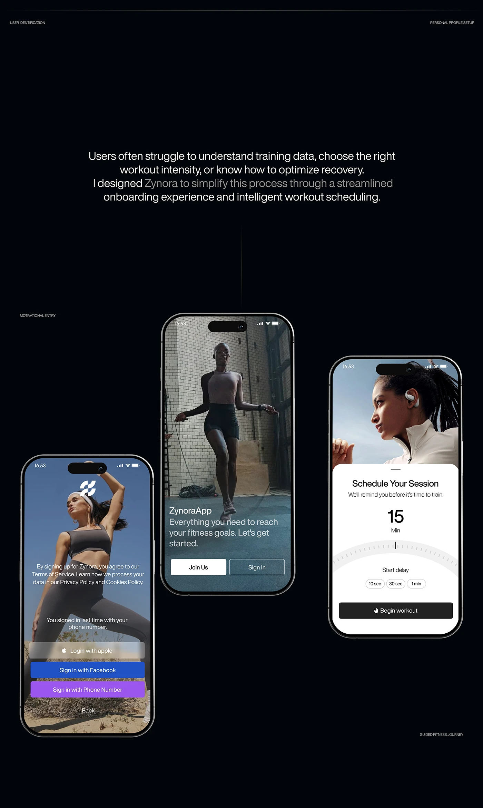

# Athlete-photo splash and sign-in, gym jump-rope welcome and a scheduling dial on a black board

**Discipline:** app ·  · **Design style:** Glassmorphism
**Tags:** fitness, onboarding, photo, dark, dial, login, white-sheet, case-study

## What it is
A black board with a paragraph in bright and dim text and three phones: a blue-sky yoga photo with logo and blur-glass sign-in buttons, a moody gym photo with Join Us and Sign In buttons, and a runner photo above a white sheet 'Schedule Your Session' with a tick dial for 15 minutes and time chips.

## What it means
Motivating and simple; full-bleed athletes set the mood before the form.

## Techniques
- Use full-bleed photos for onboarding.
- Style login buttons as translucent glass.
- Use a tick dial for durations.
- Present in a black board with bright-dim text.

## Best for
- Fitness app onboarding
- Photo-led splash screens
- Scheduling controls

## Vocabulary
- **Photo splash** — A full-bleed photo welcome screen.
- **Tick dial** — A ruler-style selector for values.
- **Glass button** — A translucent login button.
- **Bright-dim text** — Alternating text brightness.
