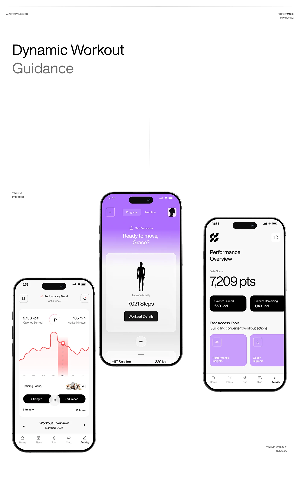

# Fitness performance screens with black pills and violet gradient

**Discipline:** app · **Design type:** Fitness app screens
**Tags:** fitness, phones, violet, black-and-white, line-chart, large-numerals, editorial-layout

## What it is
A case-study board with a big light headline 'Dynamic Workout Guidance' and three phones: a performance chart with a red highlighted column, a violet gradient home with a body silhouette, and a big daily score in black chips and violet tiles.

## What it means
Precise and motivating, with a premium athletic tone from the black and white base and single violet accent.

## Techniques
- Use one saturated gradient screen among white screens as a hero moment.
- Set the primary figure (points) in huge light type.
- Highlight a period in a chart with a coloured vertical band.
- Use black rounded chips for secondary stats.

## Best for
- Sport and health apps
- Analytics-heavy mobile UI
- Case study layouts with editorial whitespace

## Vocabulary
- **Hero screen** — The one screen given the strongest colour.
- **Highlight band** — A vertical tinted area marking a selected range on a chart.
- **Stat chip** — A small rounded box with a label and value.
- **Body silhouette** — A minimal figure used as a data anchor.
