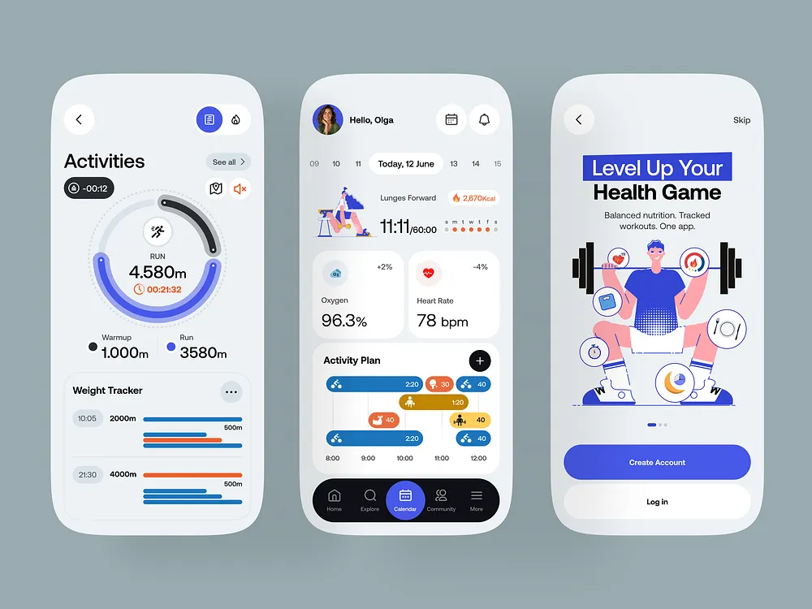

# Blue and Orange Fitness App with Flat Illustrations

**Discipline:** app · **Design type:** Fitness app screens
**Tags:** fitness, blue, orange, ring-chart, flat-illustration, gantt, onboarding

## What it is
Three light grey phones on blue-grey: an Activities screen with a dark and blue ring and a run time, a home with a date strip, an exercise illustration, oxygen and heart rate cards and an activity plan of coloured capsules on a timeline, and an onboarding 'Level Up Your Health Game' with a flat illustration of a weightlifter and floating icons, plus a dark tab bar with a blue active circle.

## What it means
A restrained blue, orange and black palette with flat illustrations feels sporty and clear.

## Techniques
- Double ring chart for run progress
- Capsule timeline for the activity plan
- Flat illustration with floating icon bubbles
- Highlighted headline word on a blue block
- Dark tab bar with a blue circle for the active tab

## Best for
- Fitness and health apps
- Flat illustration onboarding
- Capsule schedule visuals

## Vocabulary
- **Capsule timeline** — Rounded bars laid on a time scale.
- **Flat illustration** — A vector drawing with solid colours and no gradients.
- **Floating icon bubble** — A circle with an icon placed around an illustration.
