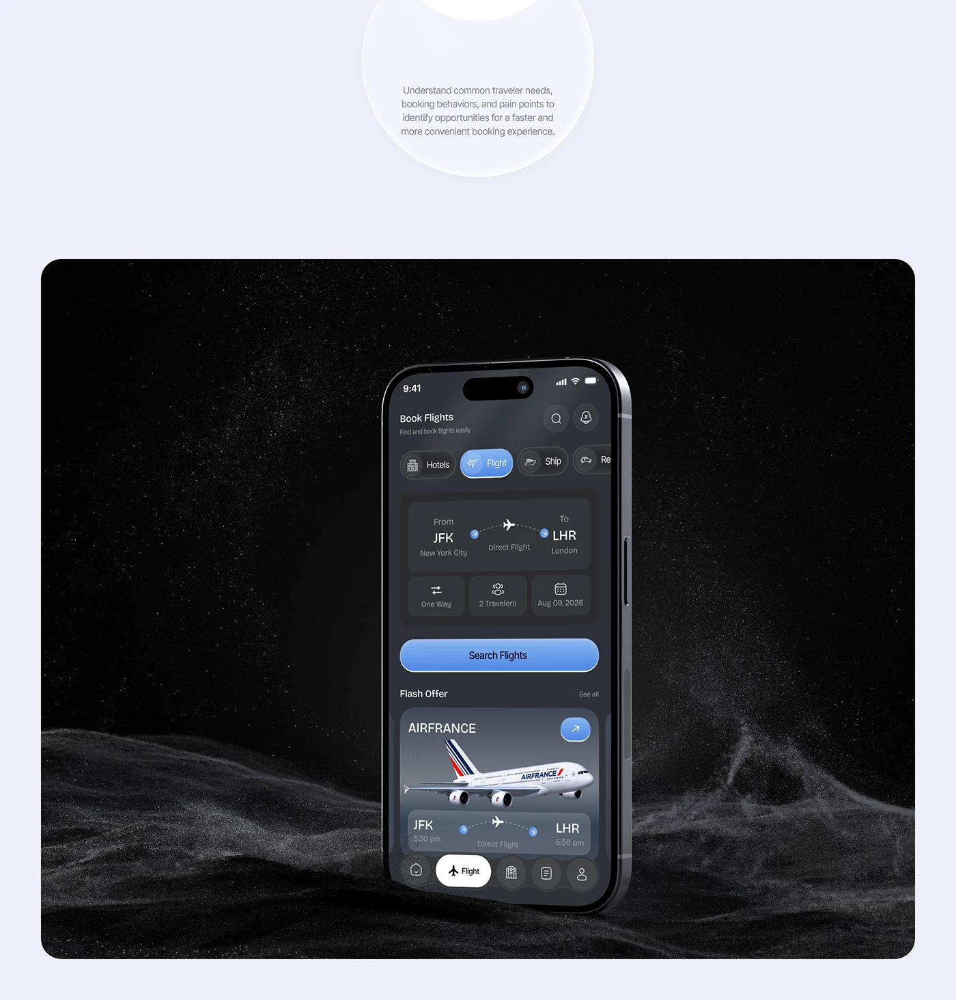

# Dark Flight Search Phone on Dust Dunes

**Discipline:** app ·  · **Design style:** 3D & Surreal
**Tags:** flight, dark, dust, particles, dune, blue, research

## What it is
A lavender page with a research blurb in a soft circle above a black rounded panel where a dark flight search phone stands among dunes of white dust particles under a starry speckle, showing a route card, Search Flights button and an Airfrance flash offer.

## What it means
The dust dunes give a cinematic, otherworldly stage that contrasts with the friendly blue UI.

## Techniques
- Particle dunes as a rendered landscape
- Dark UI with a blue gradient button
- Phone standing upright like a monolith
- Pale lavender page framing a black panel
- Soft circle holding explanatory text

## Best for
- Dark app hero renders
- Travel and flight apps
- Dramatic particle backdrops

## Vocabulary
- **Particle dune** — A landscape built from thousands of tiny dots.
- **Monolith pose** — A device standing upright like a monument.
- **Framed panel** — A dark rounded panel set on a light page.
