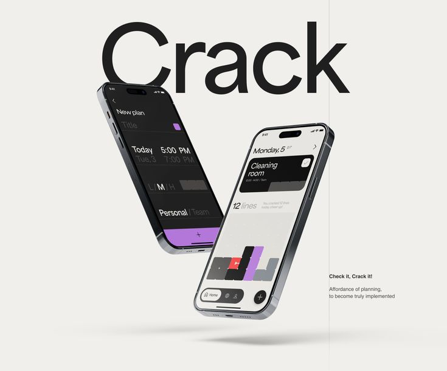

# Two Floating Phones under a Giant Headline

**Discipline:** app · **Design type:** Device mockup scene
**Tags:** floating, phones, headline, cream, purple, black, planning

## What it is
A cream slide with a giant black word 'Crack' cropped behind two floating tilted phones, one dark with a purple plan form and one light with a stacked block schedule, a thin vertical line and a small caption.

## What it means
Oversized type and floating devices feel bold and playful, and the block visual makes planning tangible.

## Techniques
- Giant headline overlapped by devices
- Two phones in dark and light versions
- Block-stack visualisation as a signature graphic
- Soft floor shadow beneath floating devices
- One thin vertical line for structure

## Best for
- Planning and productivity apps
- Concept hero slides
- Bold typographic mockups

## Vocabulary
- **Floating device** — A device shown in mid-air with a soft shadow below.
- **Overlap headline** — Large type partially covered by objects.
- **Dark and light pair** — Two themes of the same UI shown together.
