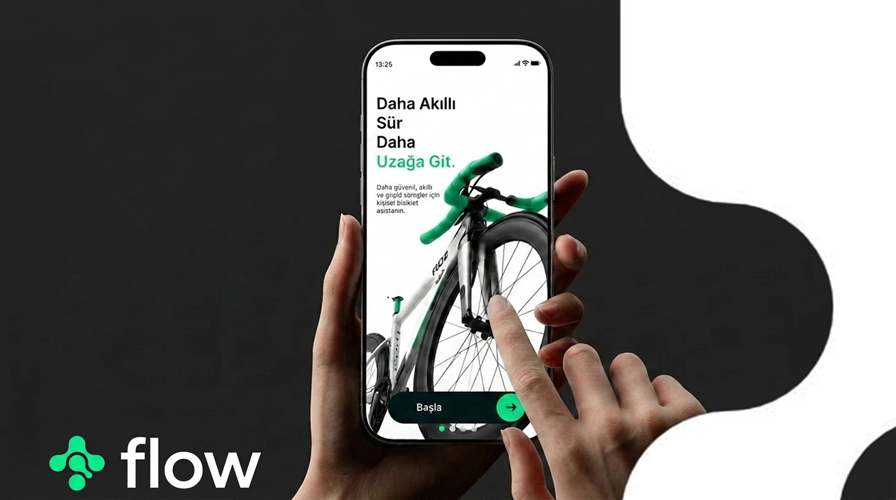

# Flow cycling app hero: a hand touching a bike photo on a phone screen against black and white curves

**Discipline:** app · **Design type:** Device mockup scene · **Design style:** Minimalist
**Tags:** cycling, hero, mint-green, hand-mockup, black-white, case-study-cover

## What it is
A cover with a black background curving into a white organic shape, a phone held by a hand with a finger touching a close-up bike photo captioned 'Daha Akıllı Sür / Daha / Uzağa Git.' with a mint 'Başla' (Start) button, and the mint 'flow' logo with a flower-like icon bottom-left.

## What it means
Tactile and premium; the touch gesture and organic black/white split give a fitness app a design-object feel.

## Techniques
- Show a finger touching the screen for tactility.
- Split the backdrop with an organic black-and-white curve.
- Keep the logo simple and place it away from the action.

## Best for
- App case study covers
- Cycling and sports brands
- Hand-interaction mockups

## Vocabulary
- **Organic curve** — A smooth, non-geometric dividing line.
- **Touch gesture** — A photo showing a finger interacting with a screen.
