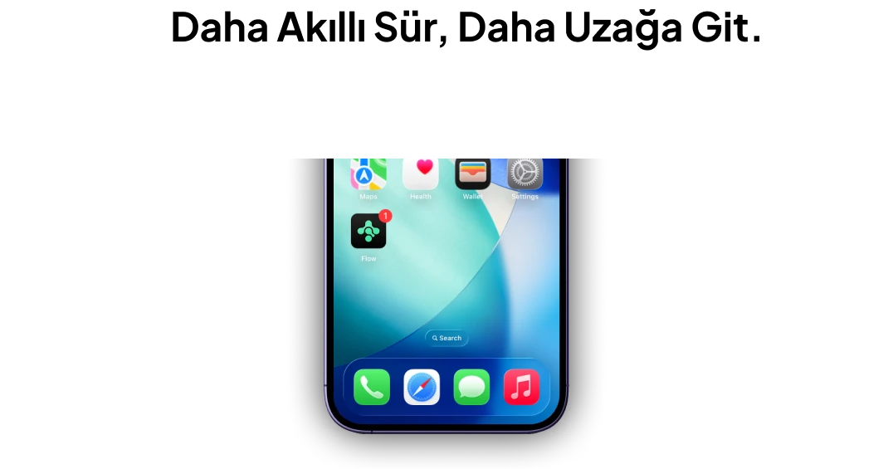

# Flow cycling app icon revealed on an iPhone lock screen with a Turkish tagline

**Discipline:** app · **Design type:** Case study slide · **Design style:** Minimalist
**Tags:** cycling, app-icon, home-screen, turkish, mint-green, case-study

## What it is
A white slide with the bold headline 'Daha Akıllı Sür, Daha Uzağa Git.' (Ride Smarter, Go Further) above a cropped iPhone showing the mint 'Flow' app icon with a red notification badge among Maps, Health, Wallet and Settings on a lock screen.

## What it means
Confident and real; placing the icon among familiar system apps makes a concept feel like a shipped product.

## Techniques
- Reveal an app icon in situ on a real lock screen.
- Lead with a benefit-driven tagline before any UI.
- Keep the palette to mint green and white.

## Best for
- App icon reveals
- Fitness and sports apps
- Case study openers

## Vocabulary
- **Icon badge** — The small number or dot on an app icon showing new activity.
- **In situ mockup** — Showing a design in its real, expected context.
