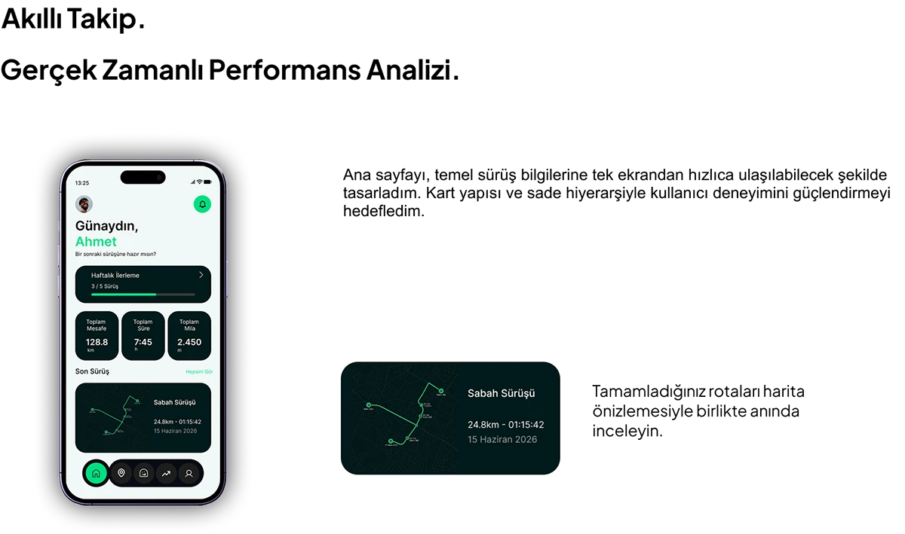

# Flow cycling app home dashboard: greeting, weekly progress bar, stat cards and a dark route-summary card

**Discipline:** app · **Design type:** Fitness app screens · **Design style:** Minimalist
**Tags:** cycling, fitness, dashboard, light-ui, progress-bar, greeting

## What it is
A light page with 'Akıllı Takip.' and 'Gerçek Zamanlı Performans Analizi.' headlines, a phone home screen greeting 'Günaydın, Ahmet' with a weekly progress bar (3/5 rides), three stat cards (distance, time, miles) and a recent-ride thumbnail, plus a separate dark route-summary card with a green route line, distance and date.

## What it means
Encouraging and legible; a personal greeting and weekly bar make daily opens feel like progress, not just data.

## Techniques
- Greet the user by name with a friendly prompt.
- Show a weekly goal as a simple progress bar.
- Summarise a completed route as its own shareable card.

## Best for
- Fitness app home screens
- Habit-building dashboards
- Case study feature slides

## Vocabulary
- **Progress bar** — A bar showing how far along a goal is.
- **Route card** — A compact summary of one completed route.
