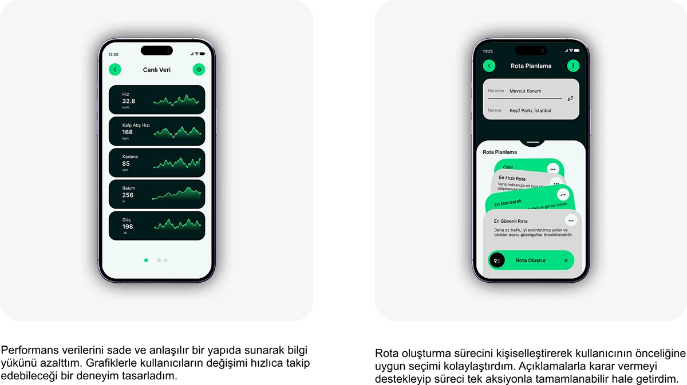

# Flow cycling app: live performance data and personalised route-planning screens on light grey cards

**Discipline:** app · **Design type:** Fitness app screens · **Design style:** Minimalist
**Tags:** cycling, fitness, route-planning, light-ui, cards, data

## What it is
Two phones on light grey cards: 'Canlı Veri' (Live Data) listing speed, heart rate, cadence, altitude and power each with a mini sparkline, and 'Rota Planlama' (Route Planning) with from/to fields and stacked route-option cards (Fastest, Scenic, Safest) with a 'Create Route' button, each with a rationale caption below.

## What it means
Data-rich yet calm; sparklines and named route personalities make dense metrics feel approachable.

## Techniques
- Pair each metric with a small sparkline trend.
- Offer named route personalities instead of raw options.
- Set data screens on light cards for a calmer read than the dark tracking view.

## Best for
- Fitness data dashboards
- Route planning UX
- Sports app case studies

## Vocabulary
- **Sparkline** — A small trend-line chart with no axes.
- **Route personality** — A named route type reflecting a different priority.
