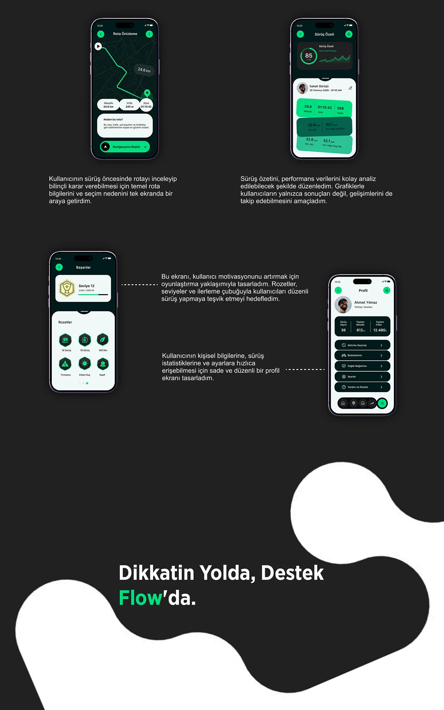

# Flow cycling app: route preview, ride summary, achievements and profile screens ending in a bold closing tagline

**Discipline:** app · **Design type:** Case study closing slide · **Design style:** Dark & Neon
**Tags:** cycling, fitness, dark-ui, achievements, profile, closing-slide

## What it is
A dark closing spread: a route-preview map, a ride-summary score card (85, distance, pace), a gamified 'Başarılar' (Achievements) screen with badges and level progress, a profile with stats and settings list, each captioned with rationale, then a bold black slide with a white organic blob and 'Dikkatin Yolda, Destek Flow'da.' (Your focus on the road, support from Flow).

## What it means
Motivating and complete; gamified badges close the loop from tracking to encouragement before the sign-off.

## Techniques
- Close a fitness flow with badges and level progress.
- End a case study with a short, punchy brand line.
- Reuse the organic blob shape from the cover as a closing bookend.

## Best for
- Fitness gamification
- Case study closings
- Sports app profile screens

## Vocabulary
- **Gamification** — Using game mechanics like badges and levels to motivate.
- **Bookend** — A visual element repeated at the start and end for unity.
