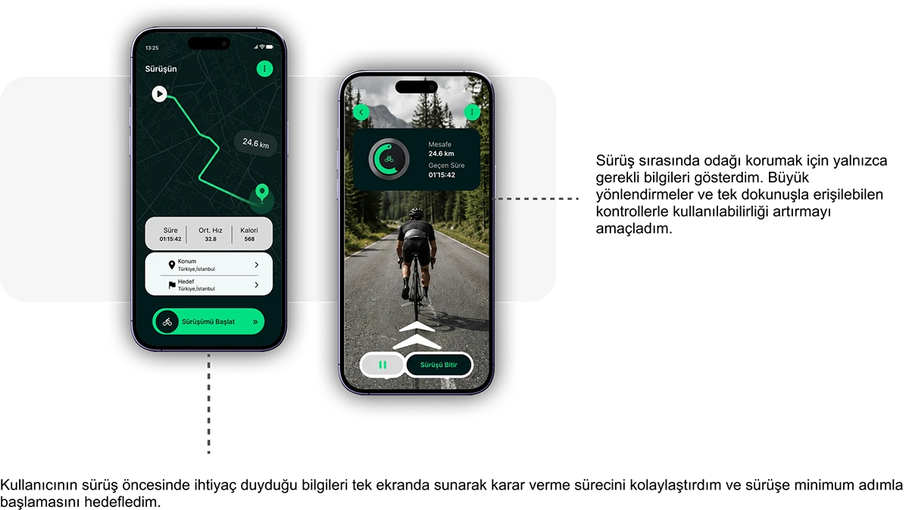

# Flow cycling app: ride overview and active-tracking screens in dark green with rationale notes

**Discipline:** app · **Design type:** Fitness app screens · **Design style:** Dark & Neon
**Tags:** cycling, fitness, dark-ui, green, route, tracking

## What it is
Two dark phone screens with glowing green accents: 'Sürüşün' (Your Ride) showing a route map, distance and start button, and an active-tracking screen with a circular progress ring, distance/time stats and a live road photo, each paired with a Turkish designer's-rationale caption and a dotted connector.

## What it means
Focused and considered; pairing each screen with the designer's own reasoning turns a UI shot into a mini case study.

## Techniques
- Caption each screen with the design rationale behind it.
- Use a dotted line to link a screen to its explanation.
- Keep only essential data visible during active use.

## Best for
- Fitness tracking apps
- UX rationale documentation
- Dark-mode sports UI

## Vocabulary
- **Progress ring** — A circular stroke showing completion or a live metric.
- **Design rationale** — The stated reasoning behind a design decision.
