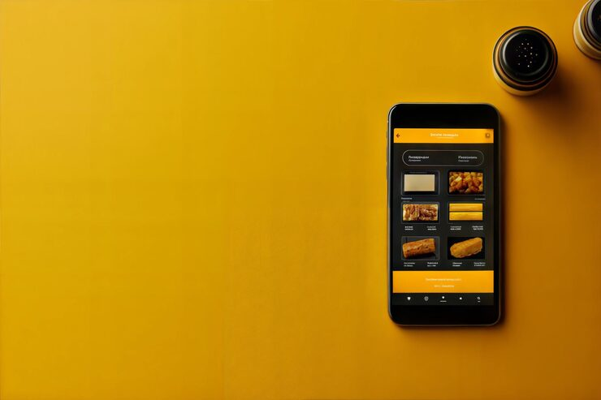

# Food delivery app menu screen on a phone lying flat on a mustard-yellow surface with salt shakers and copy space

**Discipline:** app · **Design type:** Device mockup scene · **Design style:** Photographic & Cinematic
**Tags:** food-delivery, mockup, mustard, flat-lay, dark-ui, copy-space

## What it is
A top-down photo of a phone lying on a mustard-yellow surface showing a dark food delivery app menu with recommended and popular item photo tiles, next to small stacked condiment shakers, with generous empty yellow space to the left for headline copy.

## What it means
Warm and appetising; the mustard surface and dark app UI create appealing contrast while leaving room for a marketing message.

## Techniques
- Photograph a device flat on a colour-matched surface for a lifestyle feel.
- Leave large empty copy space for headline flexibility.
- Use a dark app UI against a warm bright surface for contrast.

## Best for
- Food delivery app marketing
- Restaurant and cafe promotion
- Blog and article header photography

## Vocabulary
- **Flat lay** — A photo shot directly from above of objects arranged on a surface.
- **Copy space** — Empty area in an image left for adding text.
