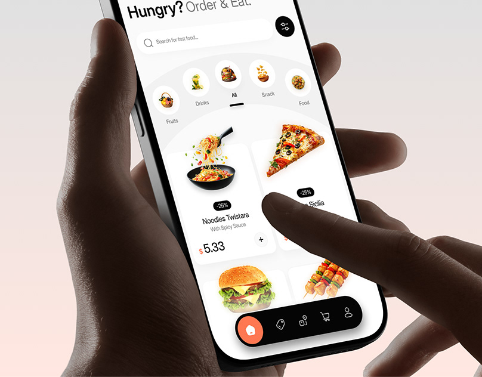

# Food ordering app with arc category selector held in both hands

**Discipline:** app ·  · **Design style:** Dark & Neon
**Tags:** food, delivery, white-ui, arc-menu, hands, black-pill-nav, orange-accent, close-up

## What it is
A close-up of two hands holding a phone. The screen has a large 'Hungry? Order & Eat.' title, search with a black filter button, a curved arc of circular category images, food cards with discount tags and prices, and a black pill tab bar with an orange home button.

## What it means
Appetising and easy; the curved arc adds motion and playfulness to browsing.

## Techniques
- Arrange categories along an arc to add rhythm.
- Use white cards with cut-out food photos and small black discount tags.
- Contrast a black floating nav with an orange active icon.
- Photograph with a hand touching the screen for interactivity.

## Best for
- Food delivery and restaurant apps
- Marketplaces with photo-led products
- Close-up mockups

## Vocabulary
- **Arc menu** — Items arranged on a curved path.
- **Discount tag** — A small black label showing a percent off.
- **Cutout food photo** — A dish with the background removed.
- **Touch mockup** — A hand shown interacting with the screen.
