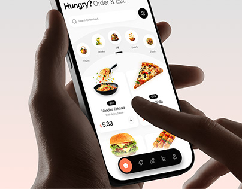

# Food ordering app close-up as a project thumbnail

**Discipline:** app ·  · **Design style:** Gradient & Aurora
**Tags:** food, delivery, thumbnail, hands, arc-menu, white-ui, project-cover

## What it is
A small-format crop of the food app in both hands showing the arc category selector, product cards and floating black nav.

## What it means
Compact and legible; the hands and large UI read even at thumbnail size.

## Techniques
- Crop tightly so the main title and food images dominate.
- Keep the surroundings a soft peach gradient.
- Use the pill nav at the bottom as an anchor.
- Let the finger point at a card for a sense of action.

## Best for
- Portfolio grid covers
- Social previews
- App case-study thumbnails

## Vocabulary
- **Thumbnail crop** — A recomposed image sized for small display.
- **Soft peach gradient** — A pale warm background.
- **Anchor nav** — A bottom bar that grounds the composition.
- **Pointer finger** — A finger touching the UI in a photo.
