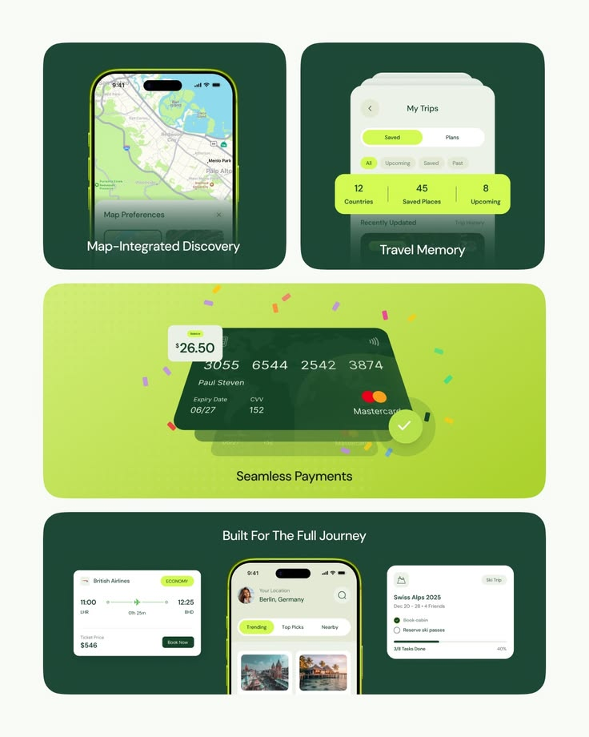

# Forest and Lime Travel Feature Tiles

**Discipline:** app ·  · **Design style:** Geometric & Bauhaus
**Tags:** travel, forest-green, lime, features, cards, map, payment, bento

## What it is
A bento of forest green and lime tiles: a map discovery phone, a trips list with a lime stat strip, a lime tile with a tilted card and confetti for payments, and a wide dark tile with a flight card, home phone and trip checklist, each with a centred caption.

## What it means
Alternating dark and lime tiles feel fresh, and confetti around the card celebrates a payment.

## Techniques
- Alternating dark green and lime tiles
- Lime stat strip overlapping a list
- Confetti pieces around a card as a success moment
- Captions centred within each tile
- Three devices and cards in one wide tile

## Best for
- Feature summaries for travel apps
- Bento feature slides
- Green and lime brand systems

## Vocabulary
- **Feature tile** — A tile dedicated to one feature with a caption.
- **Success confetti** — Small coloured pieces scattered around a confirmation.
- **Stat strip** — A row of key numbers in a coloured band.
