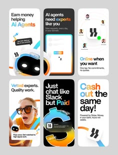

# Six vivid store screenshots for an AI expert marketplace with mixed colours and giant headlines

**Discipline:** app · **Design type:** App store presentation
**Tags:** app-store, screenshots, multicolour, black, orange, blue, bold-headline, marketplace

## What it is
A 3x2 set of portrait screenshots in white, black and cream with bold headlines ('Earn money helping AI Agents', 'Just chat like Slack but Paid', 'Cash out the same day'), a black robot face, phone UI, an orange ring and a woman in orange glasses.

## What it means
Loud and playful; different backgrounds with one logo make the set feel like a campaign.

## Techniques
- Give every screenshot a different bold background.
- Write conversational two-line headlines.
- Add one 3D or photographic hero per card.
- Keep the logo in a consistent spot.

## Best for
- Marketplace and gig app store pages
- Playful multi-colour screenshot sets
- AI product marketing

## Vocabulary
- **Screenshot set** — A row or grid of store images.
- **Conversational headline** — Copy written like speech.
- **Hero per card** — One large graphic on each screenshot.
- **Colour variety** — Different backgrounds across a set.
