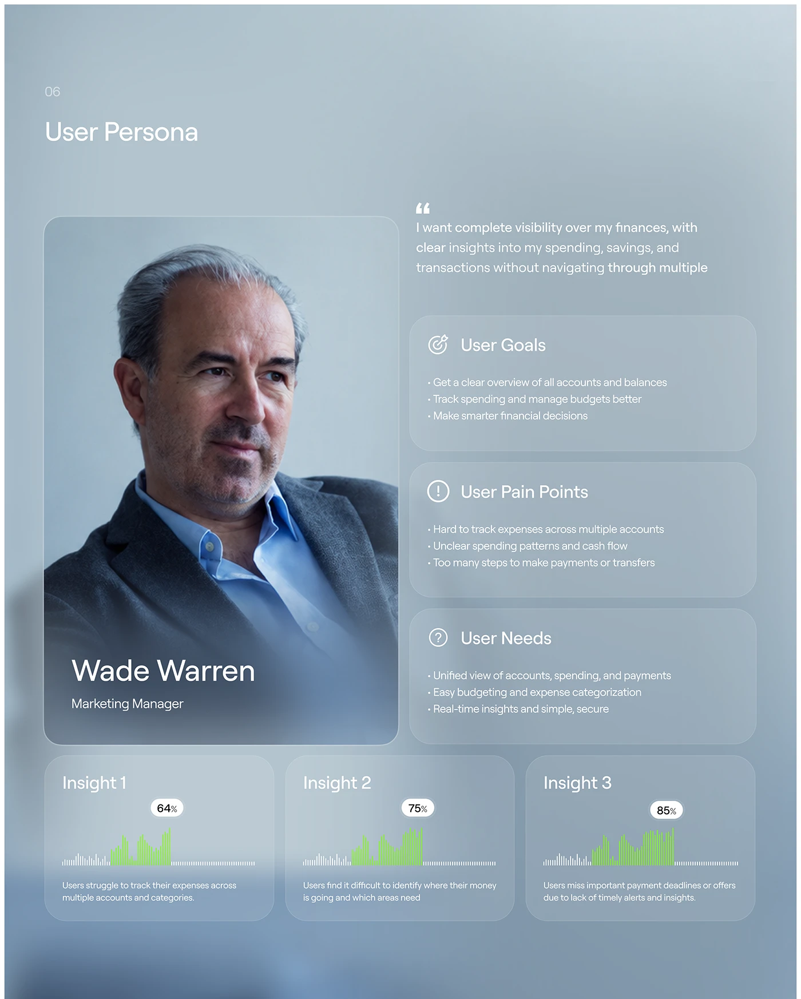

# Frosted Blue-Grey Persona with Insight Charts

**Discipline:** app ·  · **Design style:** Glassmorphism
**Tags:** persona, frosted, blue-grey, charts, green, glass-cards, portrait

## What it is
A misty blue-grey slide titled User Persona with a large portrait card of a marketing manager, a quote, three frosted cards for goals, pain points and needs, and three insight cards with striped green bar charts and percentage bubbles.

## What it means
Frosted layers over a soft photo feel calm and premium, and green striped bars add a small live accent.

## Techniques
- Frosted glass cards over a blurred background
- Portrait card with name overlay and blurred base
- Green striped bars as the only saturated colour
- Percentage bubbles above each chart
- Bullet lists in light small type

## Best for
- Persona slides
- Fintech case studies
- Glassmorphism documentation

## Vocabulary
- **Frosted card** — A translucent blurred card.
- **Insight card** — A card with a chart and a short finding.
- **Percentage bubble** — A small pill showing a value above a chart.
