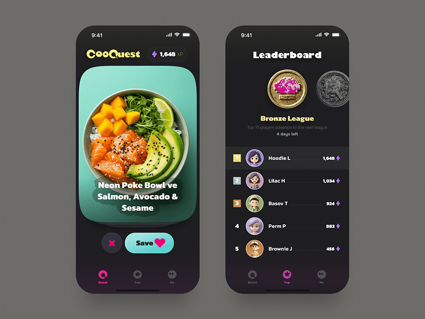

# Dark recipe app with a teal photo card, pill Save button and a coin-league leaderboard

**Discipline:** app ·  · **Design style:** Dark & Neon
**Tags:** gamification, recipes, dark, teal, pink, leaderboard, coins, rounded-cards

## What it is
Two dark phones: one with a rounded teal-glow card of a poke bowl, a yellow bubbly logo with XP chip and a big teal Save pill next to a dismiss button; and a Leaderboard with a pixel-art coin medal, 'Bronze League' text and ranked avatar rows with XP counts.

## What it means
Playful and rewarding; food swiping meets a game league.

## Techniques
- Pair a huge food photo card with swipe buttons.
- Use coin medals and 3D avatars for gamification.
- Use one pink accent for active tabs.
- Set bubbly display type for the logo.

## Best for
- Food and habit apps with game loops
- Leaderboard and progress screens
- Dark playful UI

## Vocabulary
- **League badge** — A medal showing a tier.
- **Swipe card** — A large card decided with save or dismiss.
- **XP chip** — A small counter of experience points.
- **Rank row** — A list line with position, avatar and score.
