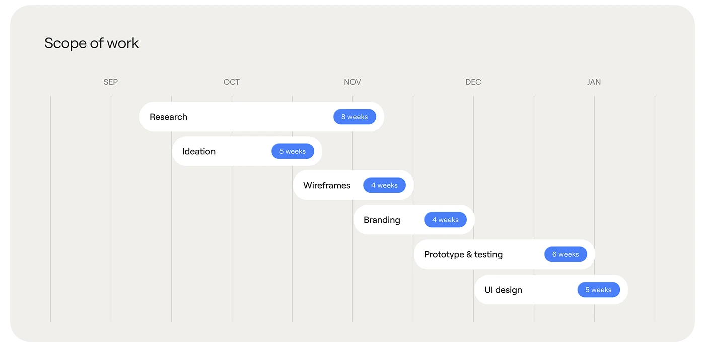

# Month-column scope slide with six white pills staggered diagonally, each with a blue week-duration tag

**Discipline:** app ·  · **Design style:** Minimalist
**Tags:** timeline, gantt, warm-grey, white-pills, blue-tags, months, process, minimal

## What it is
A warm grey rounded panel 'Scope of work' with month labels (Sep to Jan) over thin vertical lines and six white pill bars (Research, Ideation, Wireframes, Branding, Prototype & testing, UI design) offset along the months, each ending in a blue capsule with its duration.

## What it means
Clear and friendly; the pills turn a project plan into a readable staircase.

## Techniques
- Lay pills across month columns as a Gantt.
- Put duration in a blue capsule.
- Keep the background warm grey.
- Use thin vertical guides.

## Best for
- Timeline and scope slides
- Design project plans
- Minimal Gantt visuals

## Vocabulary
- **Pill Gantt** — A schedule shown with rounded bars.
- **Duration tag** — A capsule stating weeks.
- **Month column** — A vertical band labelled with a month.
- **Staircase timeline** — Bars stepping across time.
