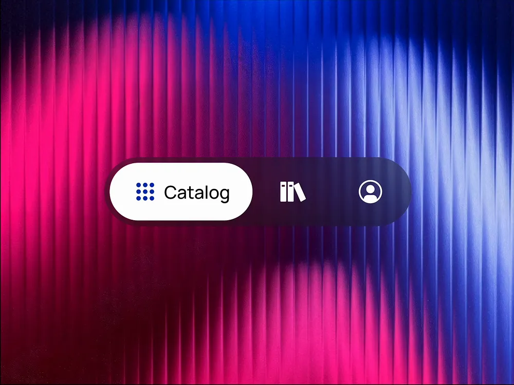

# Glass Catalog Pill Nav over Ribbed Light

**Discipline:** app · **Design type:** UI components
**Tags:** navigation, pill, glass, ribbed, magenta, blue, dark, catalog

## What it is
A tab pill floating over a background of vertical ribbed glass glowing magenta on the left and periwinkle blue on the right, with a white active segment 'Catalog' with a dot-grid icon and two translucent dark segments holding a library icon and a profile icon.

## What it means
The frosted dark pill takes on the colours behind it, and a single opaque white segment makes the active tab unmistakable.

## Techniques
- Translucent pill that picks up backdrop colour
- Opaque white active segment with a label
- Icon-only inactive tabs
- Ribbed glass gradient as a backdrop
- Centred component on a full-bleed image

## Best for
- Navigation component showcases
- Glassmorphism UI studies
- Bottom bar and tab pill designs

## Vocabulary
- **Ribbed glass** — A fluted glass texture that streaks light into vertical lines.
- **Active segment** — The opaque part of a tab pill showing the selected item.
- **Backdrop blur** — A blur applied to what lies behind a translucent element.
