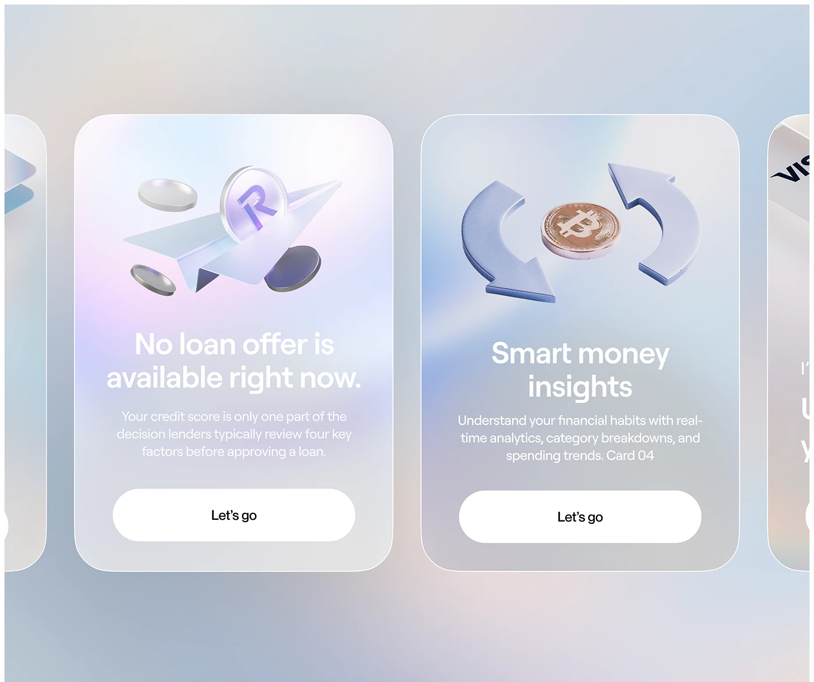

# Frosted glass cards on a pearl gradient with a 3D paper plane and coins, and a coin between cycle arrows

**Discipline:** app ·  · **Design style:** Glassmorphism
**Tags:** fintech, glass-cards, pearl, 3d-objects, carousel, white-buttons, onboarding, coins

## What it is
A pearl blue-lilac gradient with a carousel of tall frosted glass cards: one with a 3D paper plane, silver coins and an R coin under 'No loan offer is available right now.', another with a bronze bitcoin between blue cycle arrows under 'Smart money insights', each with a white pill 'Let's go' and cropped neighbours.

## What it means
Soft and futuristic; glass and 3D objects make finance feel light.

## Techniques
- Frost tall cards over a pearl gradient.
- Place a single 3D object at the top of each card.
- Use one big white pill button.
- Crop neighbouring cards to suggest a carousel.

## Best for
- Fintech onboarding and feature cards
- Glassmorphism carousels
- Pearl-gradient UIs

## Vocabulary
- **Glass carousel** — A row of translucent cards that scrolls.
- **3D hero object** — A rendered object leading each card.
- **Pearl gradient** — A soft iridescent pastel blend.
- **White pill CTA** — A white capsule button.
