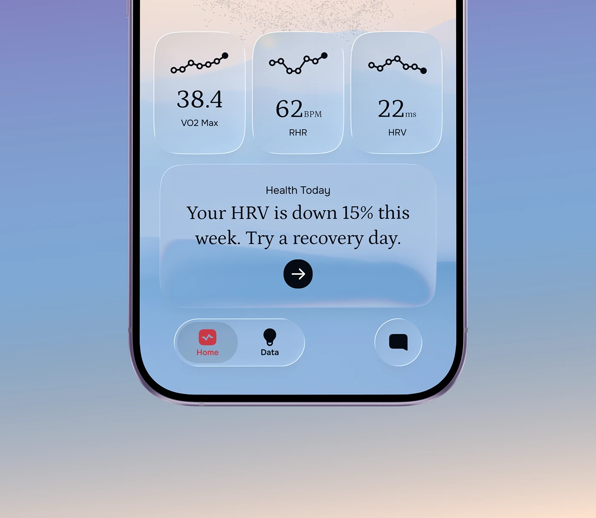

# Glassmorphic health metrics home with serif numerals

**Discipline:** app ·  · **Design style:** Glassmorphism
**Tags:** health, glassmorphism, serif-numbers, sparkline, phone-mockup, pastel-gradient, pill-navigation

## What it is
A cropped phone screen with frosted glass tiles on a blue to peach gradient. Three tiles show VO2 Max, resting heart rate and HRV with dotted sparklines and big serif numbers. A larger card gives a plain-language insight in serif type with a black arrow button, and a floating pill tab bar sits below.

## What it means
Calm and reassuring, like a wellness coach rather than a lab report; serif numerals give warmth and editorial character to data.

## Techniques
- Set key numbers in a warm serif against small sans labels so data feels human.
- Use dotted sparklines with a single filled end-point for a light, jewelry-like chart.
- Let frosted glass tiles show a soft gradient behind so depth comes from blur, not borders.
- Write the insight as a full sentence, not a metric, and give it one black circular action.
- Float the nav as a translucent pill to keep the screen airy.

## Best for
- Wellness, sleep and fitness apps
- Personal data dashboards aiming for calm
- AI coaching interfaces

## Vocabulary
- **Glassmorphism** — UI style using translucent, blurred panels over colourful backgrounds.
- **Sparkline** — A tiny word-sized line chart without axes.
- **Floating tab bar** — A navigation bar detached from the screen edge, usually pill-shaped.
- **Insight card** — A card that interprets data in plain language.
