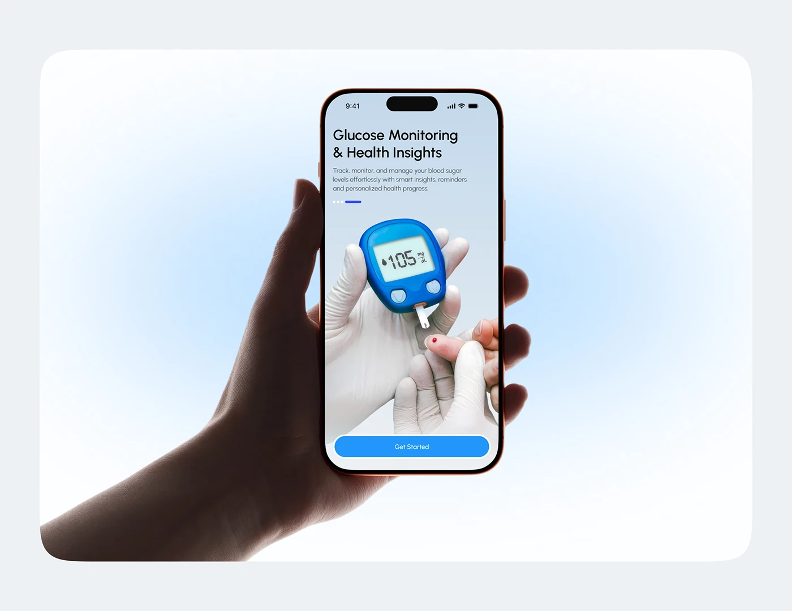

# Glucose Onboarding Screen in a Backlit Hand

**Discipline:** app ·  · **Design style:** Gradient & Aurora
**Tags:** onboarding, health, glucose, hand, blue, glow, photo

## What it is
A pale card with a soft blue glow behind a hand holding a phone whose onboarding screen shows 'Glucose Monitoring & Health Insights' and a photo of a glucose meter and finger prick, with a blue Get Started button.

## What it means
The blue glow and clear photo tell the health story at a glance, and the silhouette hand keeps focus on the screen.

## Techniques
- Radial blue glow behind the device
- Realistic photo as the onboarding illustration
- Bold title with light description
- Progress dashes for carousel position
- Full-width blue pill CTA

## Best for
- Health app onboarding presentations
- Medical device companion apps
- Clean hero mockups

## Vocabulary
- **Onboarding hero** — The main image on an app's welcome screen.
- **Radial glow** — Light spreading outward from a centre point.
- **Carousel dashes** — Small bars showing which onboarding page is active.
