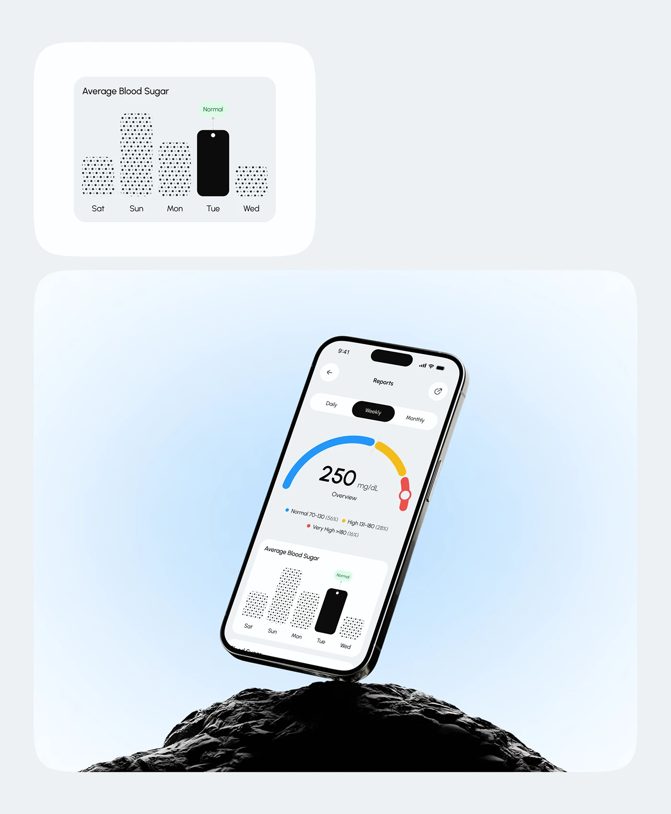

# Glucose Report Phone on Black Rock

**Discipline:** app · **Design type:** Device mockup scene
**Tags:** health, chart, dot-pattern, rock, light-blue, gauge, black

## What it is
A light grey board with a card showing a dot-patterned bar chart with one solid black bar tagged Normal, and below it a tilted phone balanced on black rock showing a multi-colour gauge and the same chart.

## What it means
Polka-dot bars and a single black bar turn data into a friendly graphic, and the rock adds a grounded contrast to the airy blue.

## Techniques
- Dot texture fills on bars with one solid highlight
- Component crop shown alongside the full mockup
- Black rock against a pale blue radial glow
- Arc gauge in blue, yellow and red for ranges
- Pill tab switch (Daily, Weekly, Monthly)

## Best for
- Health data and monitoring apps
- Chart component showcase
- Calm data presentations

## Vocabulary
- **Dot-fill bar** — A bar filled with a polka-dot pattern.
- **Range gauge** — An arc coloured by value bands.
- **Component crop** — An isolated piece of the UI shown next to the full view.
