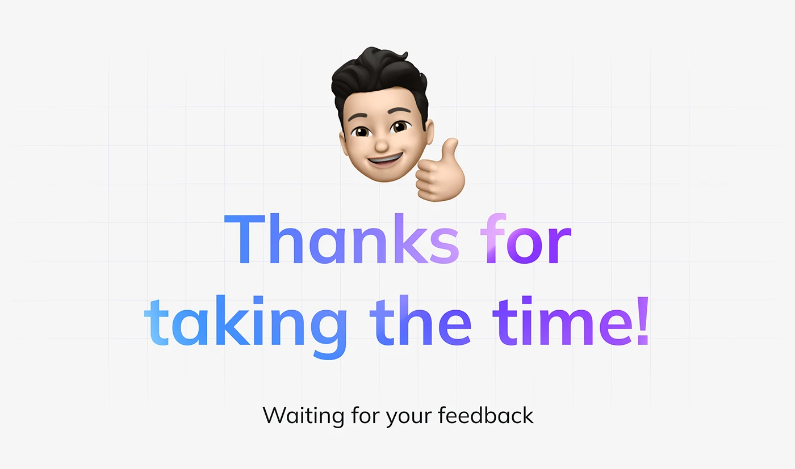

# Gradient Thanks with Memoji

**Discipline:** app ·  · **Design style:** Playful & Illustrated
**Tags:** thanks, gradient-text, memoji, grid, closing, blue-purple, friendly

## What it is
A pale grey slide with a faint grid, a cartoon avatar giving a thumbs-up, big rounded 'Thanks for taking the time!' in a blue-to-violet gradient and a small line 'Waiting for your feedback'.

## What it means
The gradient headline and friendly avatar make the sign-off warm and personal, and the feedback line invites conversation.

## Techniques
- Gradient fill running across the headline
- Personal avatar as a mascot
- Faint grid backdrop for subtle structure
- Centred stack of image, headline, small line
- Rounded friendly typeface

## Best for
- Case-study endings
- Portfolio thank-you slides
- Requests for feedback

## Vocabulary
- **Gradient type** — Lettering filled with a colour gradient.
- **Personal avatar** — A cartoon or memoji version of the author.
- **Feedback prompt** — A closing line asking for responses.
