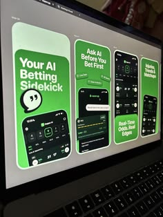

# Four green store screenshots for an AI betting assistant, photographed on a laptop screen

**Discipline:** app · **Design type:** App store presentation
**Tags:** app-store, screenshots, green, dark-ui, chat, bold-headline, laptop-photo, sports

## What it is
A slightly angled photo of a laptop showing four tall green screenshots: 'Your AI Betting Sidekick' with a bubble icon, 'Ask AI Before You Bet First', and two more, each with a bold white headline over a dark phone UI.

## What it means
Punchy and confident; green and black suit a sports and money product.

## Techniques
- Use huge bold headlines above the phone.
- Keep one green across all screenshots.
- Crop phones at the bottom edge.
- Show screenshots as a horizontal strip.

## Best for
- Store listing screenshots
- Sports and gaming apps
- Single-colour app marketing

## Vocabulary
- **Screenshot strip** — A row of store screenshots.
- **Headline-over-phone** — Bold text above a cropped phone.
- **Single-hue set** — All screenshots in one brand colour.
- **Screen photo** — A photo of a design on a monitor.
