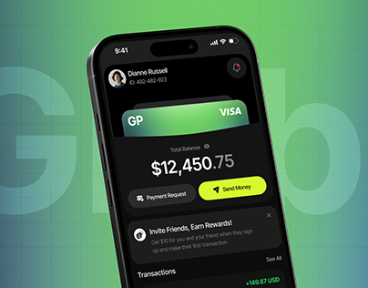

# Green Fintech Wallet on Ghost Lettering

**Discipline:** app ·  · **Design style:** Dark & Neon
**Tags:** green, lime, fintech, ghost-type, dark-ui, card, thumbnail

## What it is
A tilted phone with a dark wallet UI, green VISA card, big balance and a lime Send Money button, against a green gradient grid with giant translucent lettering.

## What it means
Lime on dark and green gradient signals fresh, growth-oriented money. Ghost letters add depth.

## Techniques
- Giant faint brand letters behind the device
- Lime CTA as the only bright element on dark UI
- Card visual matching the backdrop gradient
- Fine grid lines in the background
- Tilted device for energy

## Best for
- Fintech apps
- Cover images for project galleries
- Brands with a bold green identity

## Vocabulary
- **Ghost lettering** — Oversized low-contrast text behind a subject.
- **Tilt** — A device rotated in space for dynamism.
- **Lime accent** — A neon yellow-green used sparingly for actions.
