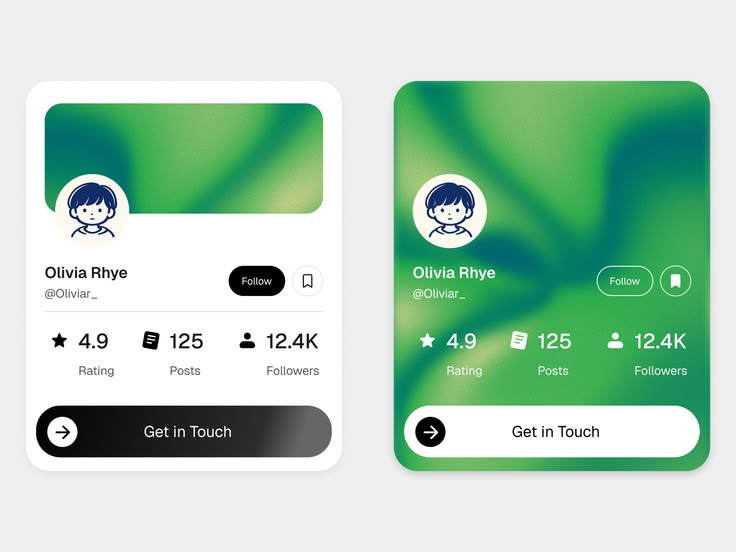

# Green Gradient Profile Cards

**Discipline:** app · **Design type:** UI components
**Tags:** profile-card, gradient, green, avatar, stats, cta, variants

## What it is
Two profile card variants: a white card with a green gradient banner, avatar, follow button, three stats and a black-to-grey Get in Touch bar, and a full-bleed green gradient card with outlined buttons and a white CTA.

## What it means
The mesh green gradient adds lush, organic colour to a simple card, and the pair proves the component's range.

## Techniques
- Mesh gradient as the card's colour source
- Inverted CTA (dark on white card, white on gradient card)
- Avatar overlapping the banner edge
- Icon-and-number stat trio
- Arrow-in-circle inside a wide pill button

## Best for
- Social and freelancer profile cards
- Component libraries
- Marketplace provider listings

## Vocabulary
- **Mesh gradient** — A multi-point blend of colours creating organic transitions.
- **Inverted variant** — A version of a component with swapped foreground and background.
- **Stat trio** — Three key numbers with icons and labels in a row.
