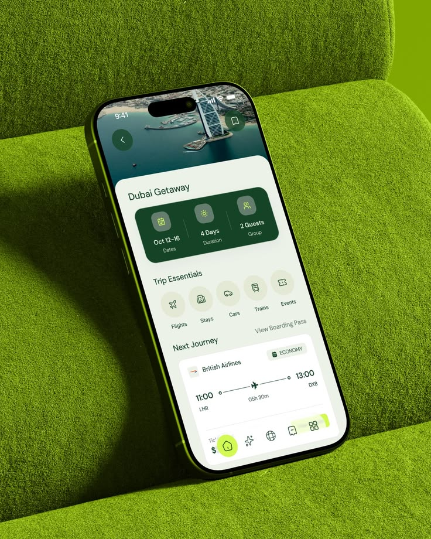

# Green Travel App on Velvet Sofa

**Discipline:** app · **Design type:** Device mockup scene
**Tags:** travel, green, velvet, lime, tonal, phone, dubai

## What it is
A phone with a lime edge lying on a moss-green velvet sofa, showing a Dubai trip screen with an aerial photo header, a dark green details bar, essentials icons and a flight card, in matching greens.

## What it means
The UI matches the velvet, making the app feel part of a cosy material world.

## Techniques
- Tonal match between the UI and the sofa
- Textured velvet as a stage
- Dark green info bar with icons
- Lime accent on the nav home button
- Soft shadow from the window

## Best for
- Travel app hero shots
- Tonal scene mockups
- Green brand launches

## Vocabulary
- **Tonal scene** — A scene whose colours match the UI.
- **Velvet stage** — A soft fabric surface used as a backdrop.
- **Trip summary bar** — A strip showing dates, duration and guests.
