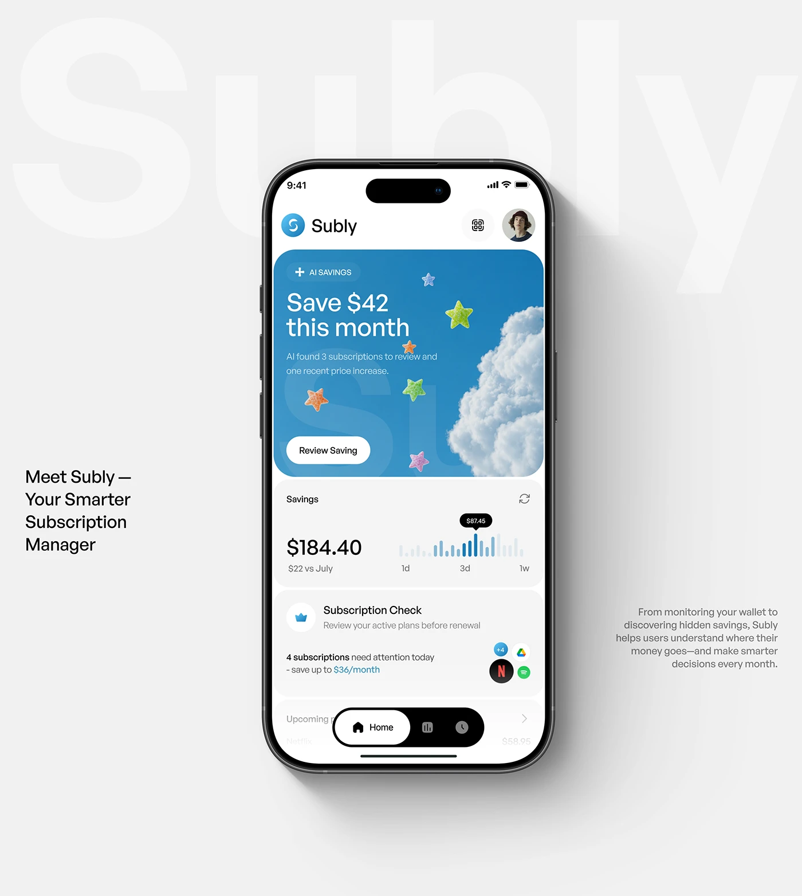

# Phone over Giant Ghost Brand Name

**Discipline:** app · **Design type:** Device mockup scene
**Tags:** ghost-type, grey, clouds, subscription, stars, blue, minimal

## What it is
A pale grey slide with huge faint 'Subly' letters behind a phone showing a cloudy blue savings card with gummy stars, a savings chart and a subscription check, with short captions left and right.

## What it means
The huge faint name brands the page without noise, and the sky card adds a playful surprise.

## Techniques
- Giant faint brand name behind the phone
- Photographic cloud with 3D star objects inside a UI card
- Short captions floating at the edges
- Floating black nav pill
- Soft shadow under the device

## Best for
- App hero slides
- Fintech with playful imagery
- Minimal presentations

## Vocabulary
- **Ghost brand name** — Oversized low-contrast text behind a subject.
- **3D sticker** — A rendered object placed in a UI as a playful accent.
- **Edge captions** — Small text set at opposite sides of a hero.
