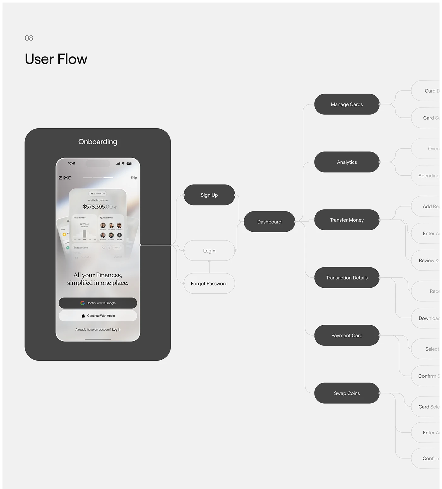

# Grey User Flow Map with Onboarding Phone

**Discipline:** app ·  · **Design style:** Corporate & Clean-Tech
**Tags:** user-flow, grey, nodes, onboarding, diagram, fintech, dark-pills

## What it is
A neutral grey page titled 'User Flow' with a dark onboarding container holding a phone, joined by lines to dark and outlined pill nodes (Sign Up, Login, Dashboard) branching to features that fade off the right edge.

## What it means
Solid vs. outlined pills separate main from secondary paths, and the fading branches imply a larger system without clutter.

## Techniques
- Filled pills for primary screens, outlined for secondary
- Branches fading and cropped at the right edge
- One dark container to hold the entry screen
- Thin grey connectors with small joint dots
- Section number and plain title top-left

## Best for
- UX flow documentation
- App architecture overviews
- Case-study process pages

## Vocabulary
- **Node** — A box or pill representing a screen or step in a flow.
- **Fade-out branch** — Lines and nodes that fade toward the edge to suggest more.
- **Primary/secondary node** — Filled versus outlined styling to show priority.
