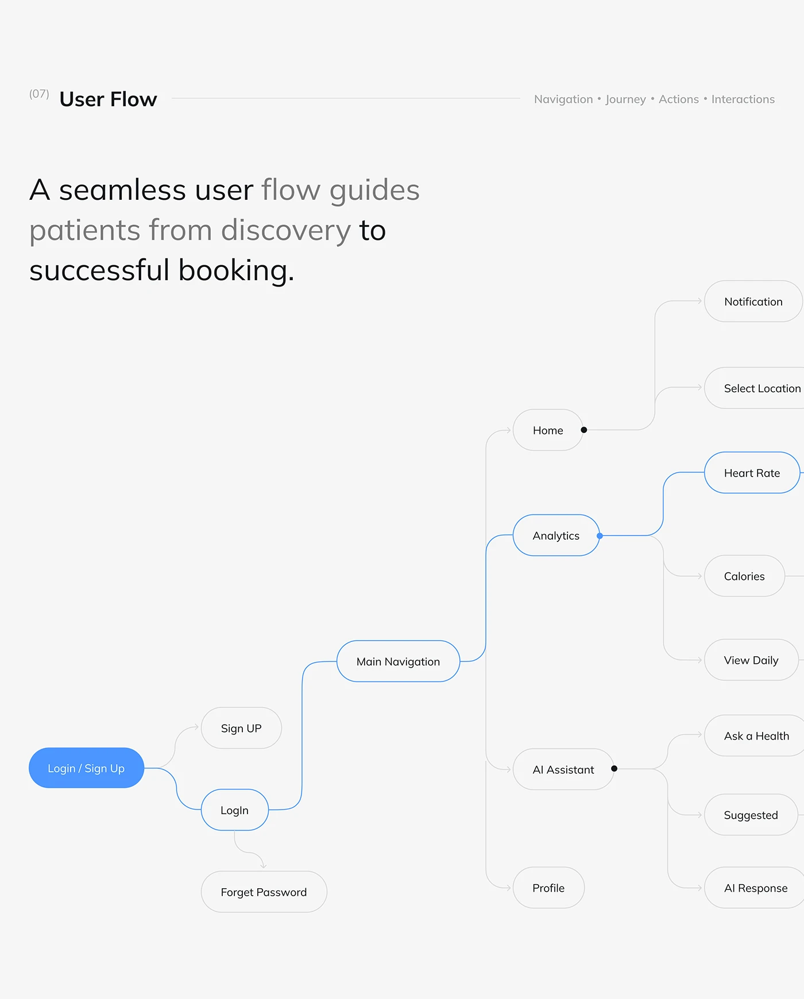

# User Flow Tree with Blue Highlighted Path

**Discipline:** app · **Design type:** UX documentation
**Tags:** user-flow, tree, grey, blue, pills, health, two-tone-headline

## What it is
A light grey slide titled User Flow with a two-tone headline, and a left-to-right tree of rounded pills from Login/Sign Up through Main Navigation to Home, Analytics, AI Assistant and Profile with sub-screens, with the active path outlined in blue and cropped at the right.

## What it means
Blue outlines mark the main path through a big tree, and cropping the edge suggests more depth.

## Techniques
- Blue path highlighting one route through a grey tree
- Filled blue start node
- Elbow connectors with small arrow heads
- Black dots at branch points
- Tree cropped at the right edge

## Best for
- User flow documentation
- App information architecture
- Highlighting a happy path

## Vocabulary
- **Happy path** — The main ideal route a user takes through a flow.
- **Branch dot** — A dot marking where a flow splits.
- **Cropped tree** — A diagram cut off at the edge to imply more.
