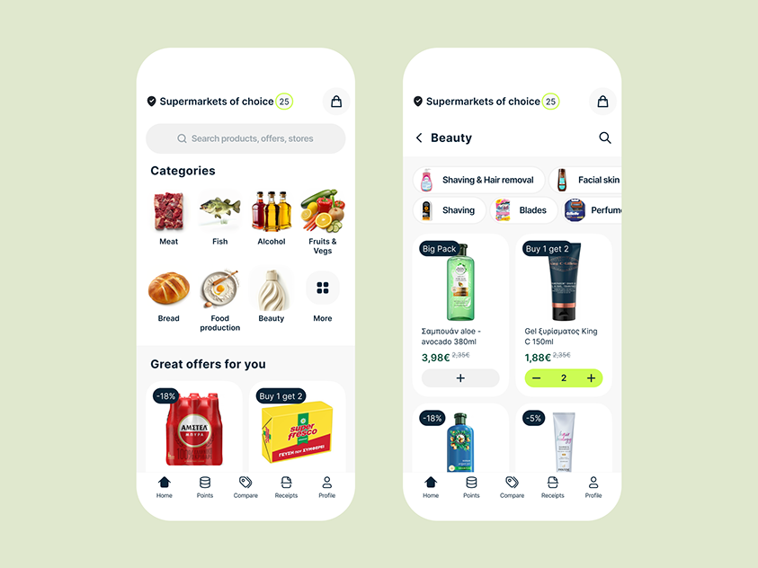

# Supermarket app on pale green: photo category grid, offer cards and lime quantity stepper

**Discipline:** app · **Design type:** E-commerce app
**Tags:** grocery, light-green, category-grid, lime, offer-badges, product-cards, tab-bar, white-ui

## What it is
Two white phones on pale green. The first has a header with a badge, search field, categories as round-cornered product photos (Meat, Fish, Alcohol, Fruits) and offer cards with dark discount tags; the second is a Beauty listing with chips and product cards where a lime stepper replaces the plus button.

## What it means
Clear and fresh; real product photography and a single lime action colour make shopping easy.

## Techniques
- Use real product cutouts for categories.
- Put discounts in small dark tags.
- Turn add buttons into lime steppers.
- Keep a five-tab bottom bar.

## Best for
- Grocery and retail apps
- Photo-based category grids
- Lime-accent commerce

## Vocabulary
- **Category photo tile** — A product image acting as category icon.
- **Discount tag** — A dark label with percentage.
- **Lime stepper** — A quantity control filled with lime.
- **Tab bar** — A bottom navigation with icons.
