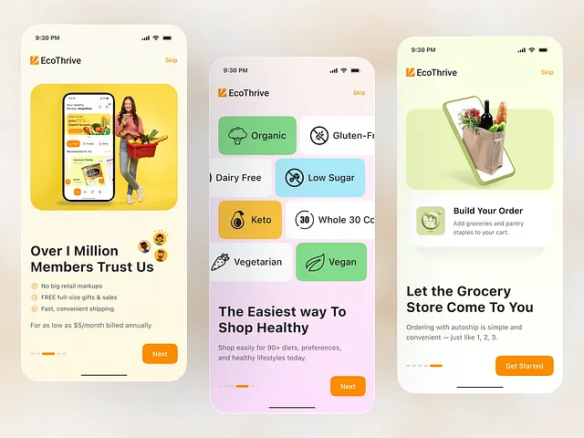

# Cream-yellow grocery onboarding: trust promise with a shopper on yellow, scrolling diet chips in pastel colours, and a grocery bag from a phone

**Discipline:** app ·  · **Design style:** Playful & Illustrated
**Tags:** onboarding, grocery, yellow, orange, pastel, diet-chips, illustration, three-screens

## What it is
Three phones on soft cream blur: a screen with a woman holding a basket in front of a phone on a yellow card, 'Over 1 Million Members Trust Us' and a checklist, a screen with overflowing rows of colourful diet chips (Organic, Gluten-Free, Dairy Free, Low Sugar, Keto, Whole 30, Vegetarian, Vegan) under 'The Easiest way To Shop Healthy', and a screen with a grocery bag emerging from a phone and 'Build Your Order', each with an orange Next or Get Started button.

## What it means
Friendly and appetising; scrolling colourful chips make diets feel like ingredients.

## Techniques
- Make diet choices rows of cropped coloured chips.
- Use one orange button.
- Pair each screen with a playful illustration.
- Fade the backdrop in pastel.

## Best for
- Grocery and health-food apps
- Chip-based preference screens
- Yellow and orange brands

## Vocabulary
- **Diet chip** — A rounded tile with an icon and diet name.
- **Cropped scroll rows** — Rows of chips cut by the screen edge.
- **Trust promise** — A member count with a short benefit list.
- **Phone illustration** — A drawing of a product coming out of a phone.
