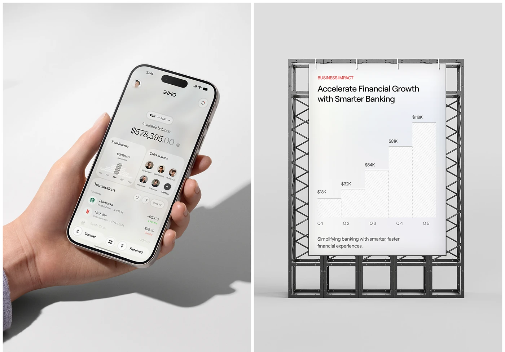

# Banking App in Hand beside Impact Chart Poster

**Discipline:** app ·  · **Design style:** Minimalist
**Tags:** banking, hand, shadow, poster, bar-chart, truss, monochrome

## What it is
A split image: at left a hand holds a pearl-grey banking app phone against a wall with a hard shadow; at right a white poster on a steel truss frame shows a business impact headline and a stepped bar chart of quarterly figures.

## What it means
Pairing a product shot with a physical poster of results links the app to its business value, in one calm monochrome.

## Techniques
- Hard directional shadow on the wall
- Stepped bar chart drawn with hatch fills
- Steel truss as a physical stand
- Two equal panels side by side
- Red eyebrow label as the only colour

## Best for
- Business impact slides
- Fintech presentations
- Monochrome mockup pairs

## Vocabulary
- **Hard shadow** — A crisp-edged shadow from strong light.
- **Hatch fill** — A pattern of fine diagonal lines used to fill shapes.
- **Eyebrow label** — A small coloured label above a heading.
