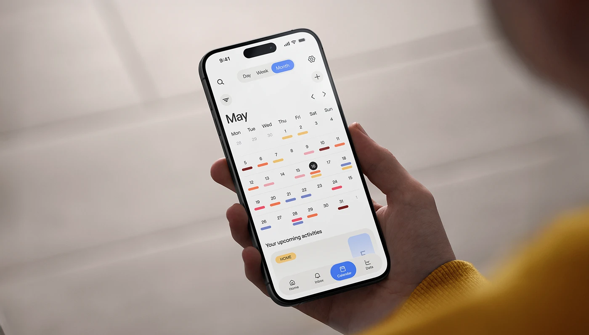

# Calendar App in Hand, Warm Blur

**Discipline:** app · **Design type:** Device mockup scene
**Tags:** calendar, hand, lifestyle, blue, warm, photography, month-view

## What it is
A hand holds a phone at an angle showing a month calendar with colored dash markers and a blue Calendar tab, against a softly blurred beige interior and a yellow sleeve.

## What it means
Real-world lifestyle context makes a utility feel approachable. The blue accent pops against warm neutrals.

## Techniques
- Shallow depth of field with a blurred yellow sleeve in the foreground
- Tilted device shown at reading angle
- Color-coded dashes under dates instead of dots or chips
- Single blue accent for selected states
- Neutral warm backdrop for the pale UI

## Best for
- Calendar and planner apps
- Lifestyle app presentations
- Realistic mockup alternatives to flat renders

## Vocabulary
- **Depth of field** — The range of distance that appears sharp; shallow means most is blurred.
- **Lifestyle mockup** — A device shown in real use by a person.
- **Dash marker** — A short coloured line under a date indicating events.
