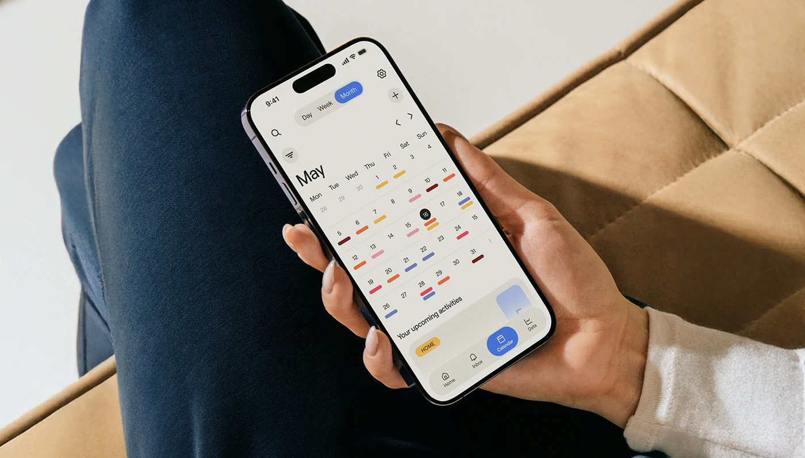

# Month Calendar in Hand on Tan Leather

**Discipline:** app ·  · **Design style:** 3D & Surreal
**Tags:** calendar, month-view, hand, leather, tan, navy, dash-markers

## What it is
A lifestyle crop of a hand holding a phone with a cream month calendar showing coloured dash markers under dates, a Day/Week/Month toggle and a floating blue Calendar tab, against navy trousers and a tan quilted leather sofa.

## What it means
Warm neutral surroundings match the cream UI, and coloured dashes add subtle life to a grid.

## Techniques
- Coloured dash markers under dates
- Blue selected tab as the single cool accent
- Natural lifestyle setting with warm leather
- Segmented Day/Week/Month toggle
- Tilted phone in a relaxed grip

## Best for
- Calendar and planner apps
- Lifestyle mockups
- Warm-toned interfaces

## Vocabulary
- **Dash marker** — A short coloured line under a date showing an event.
- **Segmented toggle** — A joined set of options with one selected.
- **Lifestyle mockup** — A device shown in real everyday use.
