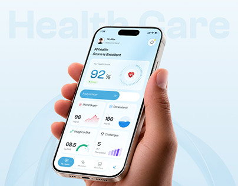

# Health Care Phone with Ghost Title and Rings

**Discipline:** app ·  · **Design style:** Geometric & Bauhaus
**Tags:** health, hand, ghost-type, light-blue, rings, score, cover

## What it is
A pale blue cover with a hand holding a phone showing a 92% health score card, an analyse button and metric cards, with giant faint 'Health Care' lettering behind and concentric rings in the background.

## What it means
Soft blue tones and rings feel calm and clinical, and the hand keeps it human.

## Techniques
- Ghost lettering cropped behind the phone
- Concentric circles as a light background motif
- Pale blue palette across UI and scene
- Dark-skinned hand in strong contrast to pale UI
- Blue pill call to action inside the UI

## Best for
- Health-tracking app covers
- Soft medical brands
- Case-study thumbnails

## Vocabulary
- **Ghost lettering** — Oversized faint text behind a subject.
- **Concentric rings** — Circles sharing a centre used as decoration.
- **Score card** — A card showing an overall health score.
