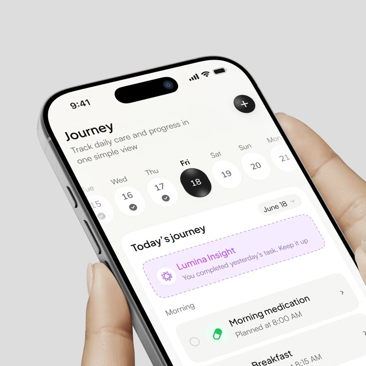

# Journey Day Planner in Hand

**Discipline:** app ·  · **Design style:** Dark & Neon
**Tags:** planner, close-up, white, black, lilac, medication, date-picker

## What it is
A close-up of a hand holding a phone showing a Journey screen: a week date strip with a black selected date, a dashed lilac insight card and a medication task list, on a light grey background.

## What it means
Big date bubbles and clear cards make the day feel manageable, and the dashed lilac card gives friendly guidance.

## Techniques
- Selected date as a black glossy pill
- Dashed outlined card for AI insight
- Green pill icon for medication
- Tight crop on the top of the screen
- Neutral grey backdrop

## Best for
- Care and habit planners
- Close-up hero crops
- Health reminder apps

## Vocabulary
- **Date strip** — A row of days with the current one highlighted.
- **Insight card** — A card giving personalised feedback.
- **Tight crop** — A close framing that enlarges part of a device.
