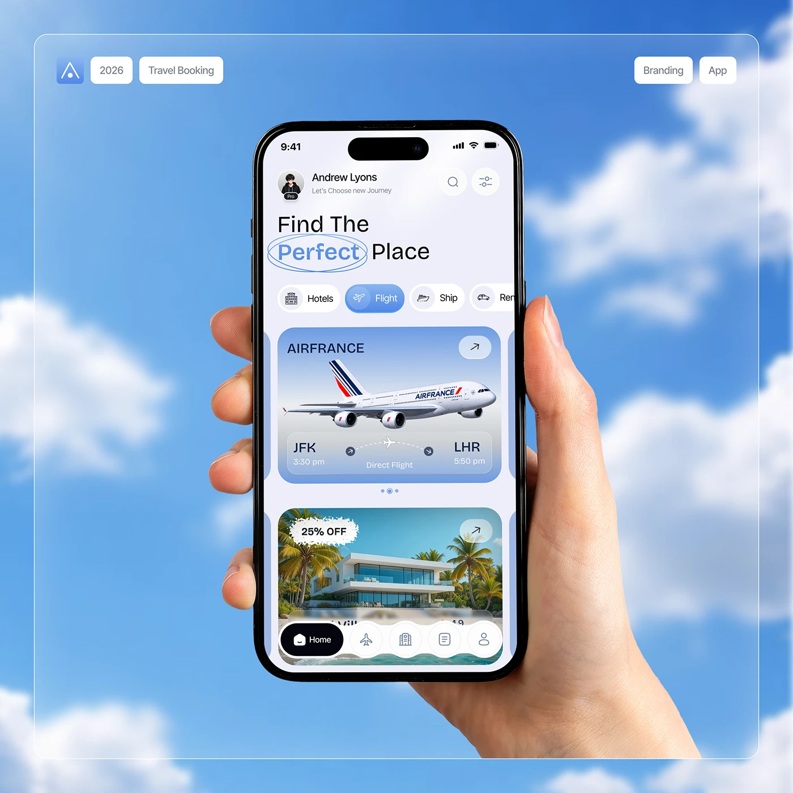

# Hand-Held Phone Against Sky

**Discipline:** app · **Design type:** Device mockup scene
**Tags:** sky, hand, travel, light, glass-frame, photo-composite

## What it is
A hand holds a phone showing a light travel home screen, against a photographic cloudy sky, inside a thin translucent frame with pill labels above.

## What it means
The sky ties directly to flight themes, and the hand adds human scale. The airy palette feels optimistic.

## Techniques
- Real hand and phone composited over a themed photo backdrop
- Frosted inset frame with pill tags as metadata
- Blue in the UI tinted to match the sky
- Circled highlight around a word
- Phone crop cutting off at the bottom

## Best for
- Travel app case-study covers
- Social media app announcements
- Lifestyle app hero imagery

## Vocabulary
- **Metadata pill** — A small rounded label giving year, category or discipline.
- **Composite** — An image assembled from multiple sources.
- **Inset frame** — A thin border inside the canvas edge.
