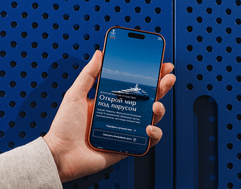

# Hand holding a phone against a perforated cobalt panel

**Discipline:** app · **Design type:** Device mockup scene
**Tags:** mockup, phone-in-hand, travel, cobalt, orange-accent, photographic, case-study-cover

## What it is
A photographic mockup: a hand holds a phone with an orange frame in front of a cobalt perforated metal wall. The screen shows a full-bleed ocean photo with a serif headline about sailing.

## What it means
Bold, tactile and aspirational; the saturated blue-orange complement gives an instant editorial punch.

## Techniques
- Choose a real-world textured background in the app's brand colour for a stage.
- Use a complementary accent (orange phone case) to separate the device from the background.
- Let a real hand hold the device to add scale and human presence.
- Repeat the wall's dot pattern as a pattern language for the brand.

## Best for
- App launch and case-study covers
- Travel and luxury mobile experiences
- Portfolio thumbnails

## Vocabulary
- **In-hand mockup** — A device photographed being held, for realism.
- **Complementary contrast** — Using opposite colours (blue/orange) so both stand out.
- **Perforated texture** — A surface pattern of regular holes.
- **Hero shot** — The main image chosen to sell a project.
