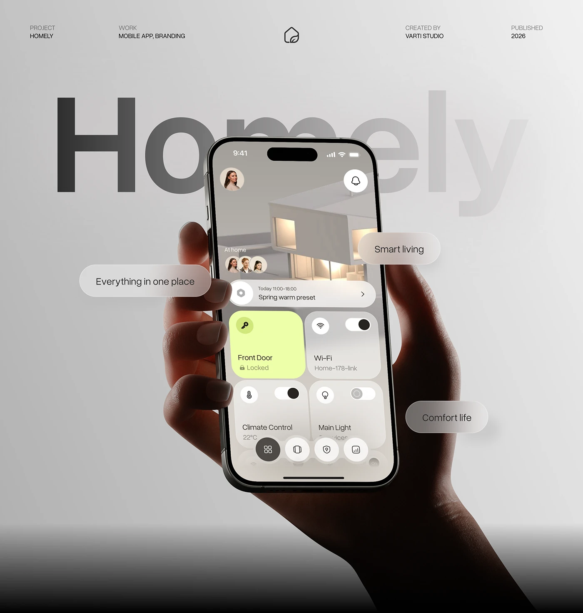

# Smart Home App with Glass Pills over Ghost Name

**Discipline:** app · **Design type:** Device mockup scene
**Tags:** smart-home, grey, hand, glass-pills, ghost-type, lime, metadata

## What it is
A grey gradient cover with a hand holding a cream smart-home UI (house render, lime door card, toggles), giant fading 'Homely' behind, frosted pill tags around and metadata across the top.

## What it means
Frosted pills describe the brand feelings around the phone, and the dark fade at the base grounds the scene.

## Techniques
- Ghost name fading from dark to light
- Frosted pill tags orbiting the phone
- Lime card as the only bright accent
- Dark gradient at the base
- Small metadata row and logo across the top

## Best for
- Smart-home brand covers
- Hero images with keyword tags
- Neutral premium mockups

## Vocabulary
- **Frosted pill** — A blurred translucent rounded label.
- **Keyword tag** — A short word or phrase floated near a product.
- **Base fade** — A dark gradient at the bottom edge of an image.
