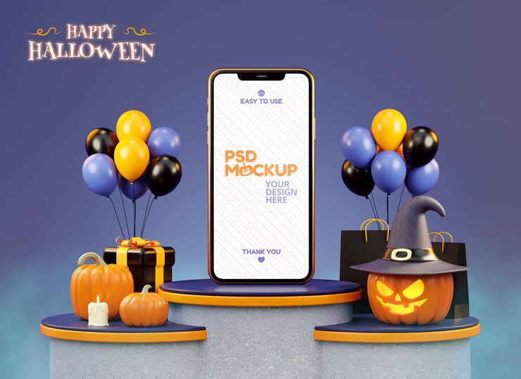

# 'Happy Halloween' phone mockup on a 3D podium flanked by pumpkins, gift boxes and balloon clusters

**Discipline:** app · **Design type:** App store presentation · **Design style:** 3D & Surreal
**Tags:** halloween, 3d-render, mockup, pumpkin, podium, seasonal

## What it is
A purple-blue 3D scene with a phone mockup on a rounded podium at centre, flanked by two lower podiums holding jack-o'-lanterns, a gift box, a candle and a witch-hat pumpkin, with black, orange and purple balloon clusters and a script 'Happy Halloween' title.

## What it means
Festive and premium; a full 3D staged scene turns a simple app mockup into a seasonal retail moment.

## Techniques
- Stage a device mockup on a multi-level 3D podium display.
- Flank the hero podium with themed props at lower levels.
- Use balloon clusters to add colour and festivity.

## Best for
- Seasonal app promotions
- Halloween retail marketing
- 3D staged mockup presentations

## Vocabulary
- **Podium display** — A staged 3D scene using pedestals of different heights.
- **Prop staging** — Arranging themed objects around a hero subject for context.
