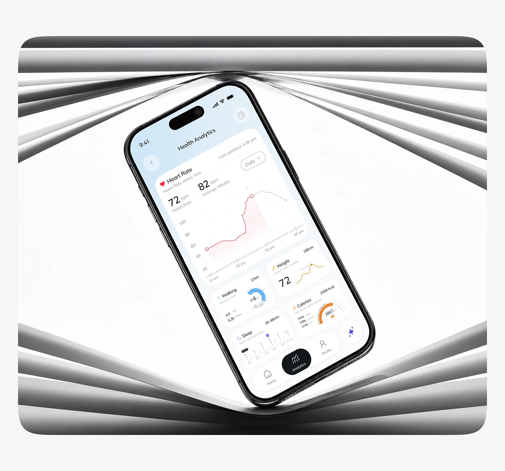

# Health Analytics Phone in Chrome Blinds

**Discipline:** app ·  · **Design style:** 3D & Surreal
**Tags:** health, chrome, blinds, white, grey, tilted, analytics

## What it is
A rounded panel where a phone showing a Health Analytics heart rate chart is tilted in the centre of a white space framed by converging grey chrome slats above and below.

## What it means
The slats converge toward the phone like a lens, adding motion and drawing the eye to the screen.

## Techniques
- Converging chrome slats as a frame
- White centre space around the device
- Tilted phone in the middle
- Monochrome scene with pastel UI
- Rounded panel on pale page

## Best for
- Health analytics mockups
- Abstract chrome scenes
- Centre-focus device shots

## Vocabulary
- **Converging lines** — Lines meeting toward a focal point.
- **Chrome slats** — Reflective metal strips used as scene elements.
- **Centre focus** — A composition drawing all lines to the middle.
