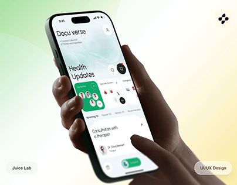

# Health-updates app held by a dark hand against a pale green-to-yellow gradient

**Discipline:** app · **Design type:** Device mockup scene
**Tags:** health, green, gradient, hand, mockup, white-ui, project-cover, pills

## What it is
A dark hand holds a tilted phone with a white health UI, a big 'Health Updates' title, green cards and a consultation entry, on a soft green and yellow gradient with a small studio pill and a service pill at the bottom.

## What it means
Fresh and caring; green light suits wellness.

## Techniques
- Hold the phone at an angle.
- Match background to UI green.
- Add corner pills for studio and discipline.
- Use a soft gradient.

## Best for
- Health app covers
- Case study thumbnails
- Green wellness brands

## Vocabulary
- **Corner pill** — A capsule label in a corner.
- **Gradient backdrop** — A soft colour blend behind a device.
- **Hand-held cover** — A cover with a hand holding the device.
- **Tilted UI** — A screen shown at an angle.
