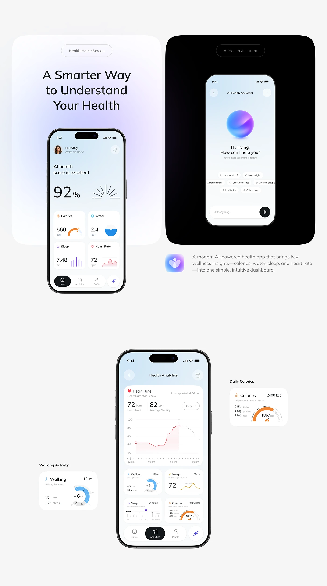

# Health Home, Assistant and Analytics Screens

**Discipline:** app ·  · **Design style:** Geometric & Bauhaus
**Tags:** health, ai-assistant, analytics, orb, white, black, tiles

## What it is
A light board with two large tiles, a pale one with a headline and the health home phone and a black one with an AI assistant phone showing a gradient orb, plus an analytics phone and enlarged calorie and walking cards.

## What it means
Contrasting a pale and a black tile shows the same product in two moods, and enlarged cards reveal detail.

## Techniques
- Light and black tiles side by side
- Gradient orb as the assistant's face
- Enlarged component cards beside the phone
- Section label pills above each screen
- Sunburst score and coloured icons per metric

## Best for
- Health app case studies
- AI assistant screens
- System overview boards

## Vocabulary
- **Section pill** — A small rounded label naming a section.
- **Component enlargement** — A UI piece shown large beside the full screen.
- **Assistant orb** — A glossy sphere representing an AI assistant.
