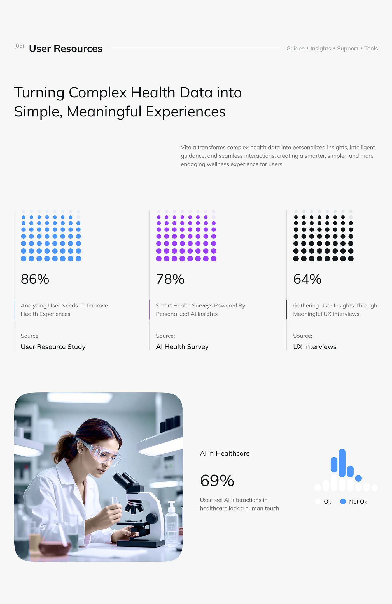

# Health Research Dot-Matrix Stats

**Discipline:** app ·  · **Design style:** Minimalist
**Tags:** research, dot-matrix, stats, health, purple, blue, black, photo

## What it is
A grey slide titled User Resources with three columns of dot-grid graphics in blue, purple and black filling toward 86%, 78% and 64%, source labels, a rounded lab photo and a 69% micro bar chart.

## What it means
Dot grids turn percentages into countable units and colour-code the sources, making numbers easy to grasp.

## Techniques
- Dot matrix as a percentage fill visual
- One colour per data source with a coloured rule beside the caption
- Big light numerals under each grid
- Rounded photo beside a stat for human context
- Ok/Not ok mini bar legend

## Best for
- Research and survey slides
- Health-tech case studies
- Data storytelling with a light touch

## Vocabulary
- **Dot matrix** — A grid of dots where filled dots represent a proportion.
- **Source tag** — A label naming where a statistic came from.
- **Colour-coded column** — A column tied to one data source by colour.
