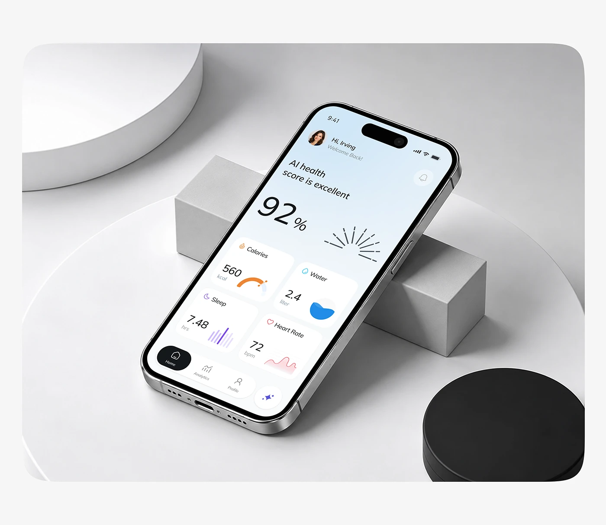

# Health Score Phone on White Plinths

**Discipline:** app ·  · **Design style:** 3D & Surreal
**Tags:** health, white, plinth, grey, black-disc, score, tilted

## What it is
A grey rounded panel with a phone tilted across a white block and cylinder, next to a black disc, showing a light blue 92% health score, a sunburst graphic and four metric cards (calories, water, sleep, heart rate).

## What it means
Simple geometric blocks in white and grey with one black disc give a calm, gallery-like stage.

## Techniques
- White blocks and cylinders as a stage
- One black disc as the contrast
- Phone leaning against a block at an angle
- Light blue gradient inside the UI
- Rounded grey panel background

## Best for
- Health app mockups
- Geometric product staging
- Calm neutral scenes

## Vocabulary
- **Geometric stage** — Simple solids used as props in a product scene.
- **Contrast disc** — A single dark shape balancing a pale scene.
- **Sunburst graphic** — Radiating lines drawn like a rising sun.
