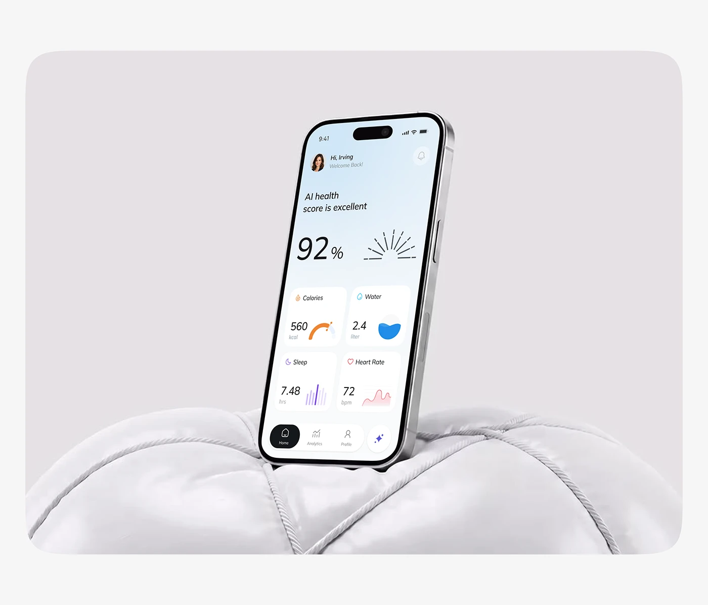

# Health Score Phone in a Quilted Cushion

**Discipline:** app · **Design type:** Device mockup scene
**Tags:** health, white, cushion, quilted, grey, cards, sunburst

## What it is
A phone tilted and planted into a puffy white quilted cushion inside a rounded grey panel, showing an AI health score of 92% with a sunburst, calorie, water, sleep and heart-rate cards.

## What it means
The soft padded prop suggests comfort and care, and the neutral scene keeps the pastel UI in focus.

## Techniques
- Soft quilted object as a stage
- Monochrome grey and white scene
- Small coloured icons per health metric
- Sunburst line graphic beside the score
- Rounded panel on pale page

## Best for
- Wellness and health apps
- Tactile mockup staging
- Calm neutral covers

## Vocabulary
- **Soft prop** — A padded or quilted object used as a stage.
- **Health score** — A single number summarising overall wellbeing.
- **Metric grid** — A 2-by-2 layout of small stat cards.
