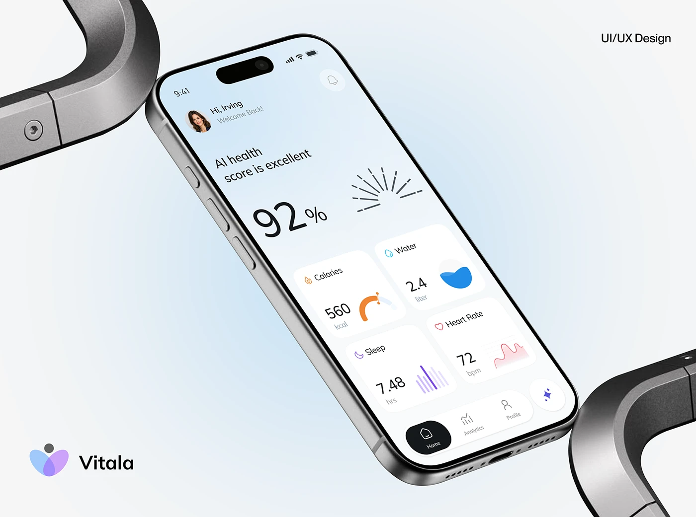

# Health Score Phone between Chrome Brackets

**Discipline:** app ·  · **Design style:** 3D & Surreal
**Tags:** health, chrome, tilted, pale-blue, logo, score, cover

## What it is
A pale blue cover with a phone tilted at a steep angle showing a 92% AI health score and metric cards, held between two chrome bracket shapes at the corners, a logo lockup bottom left and a discipline tag top right.

## What it means
Chrome forms cradle the phone like a machine, adding a hard-edged industrial contrast to the soft UI.

## Techniques
- Chrome brackets at two corners as a frame
- Phone rotated diagonally across the frame
- Pale blue gradient background
- Logo lockup and discipline tag in opposite corners
- Sunburst score graphic in the UI

## Best for
- Health-tech covers
- Product renders with metal props
- Minimal soft-tone mockups

## Vocabulary
- **Chrome bracket** — A metal L-shaped form used as a scene prop.
- **Diagonal device** — A phone rotated off-axis to add motion.
- **Corner tags** — Small labels at the frame corners.
